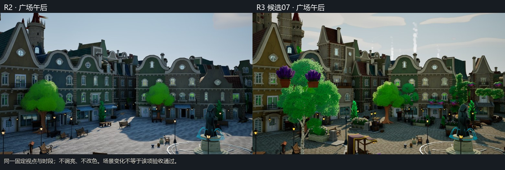
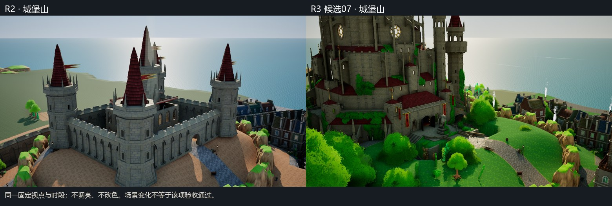
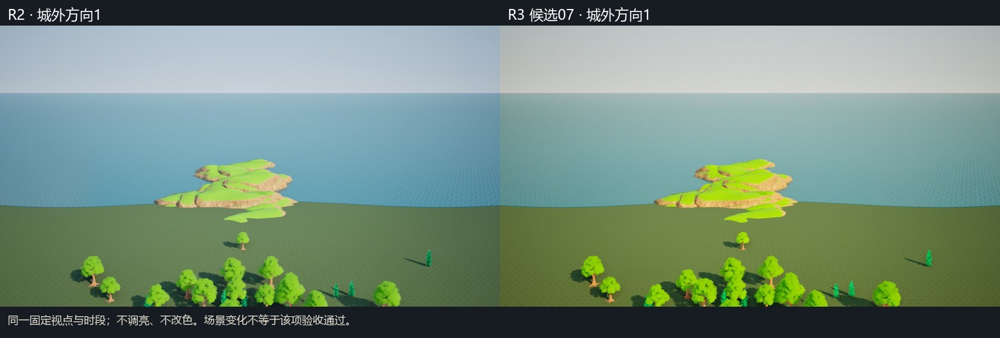
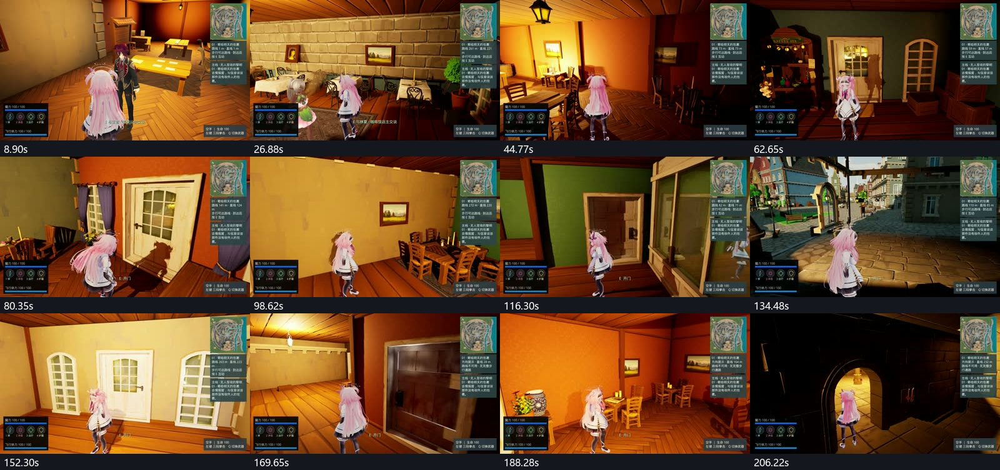
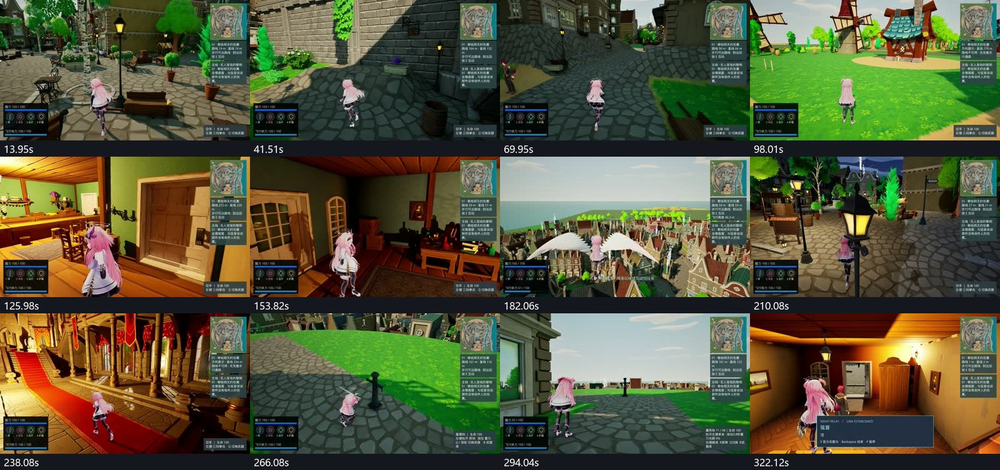
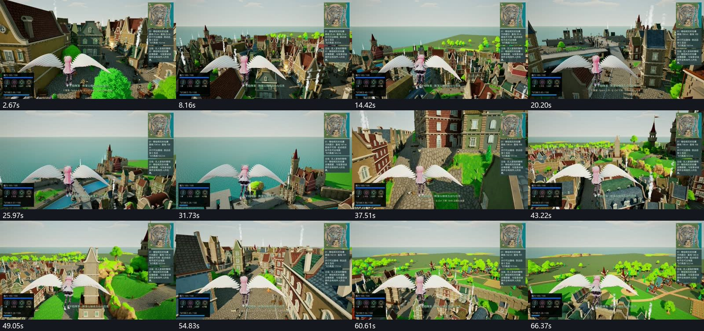
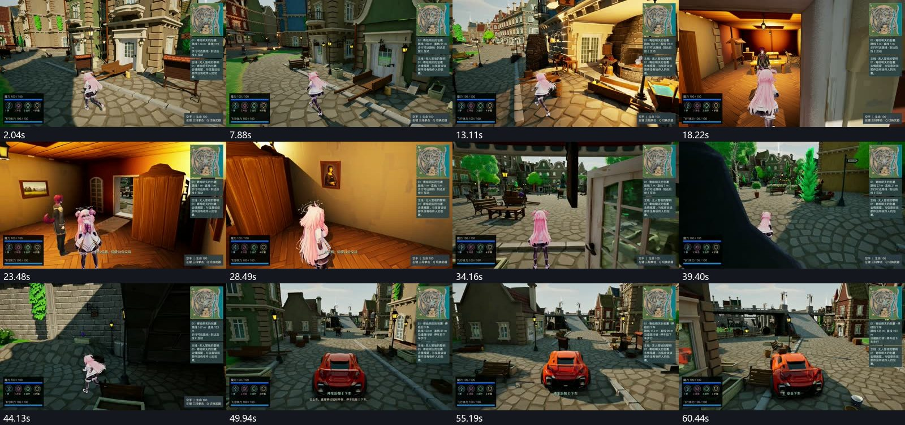
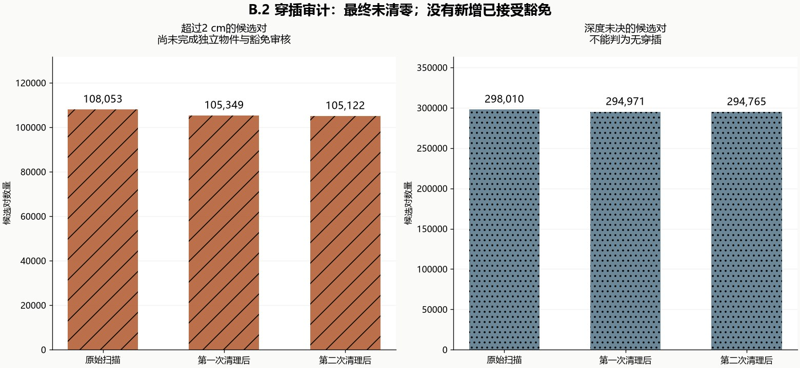
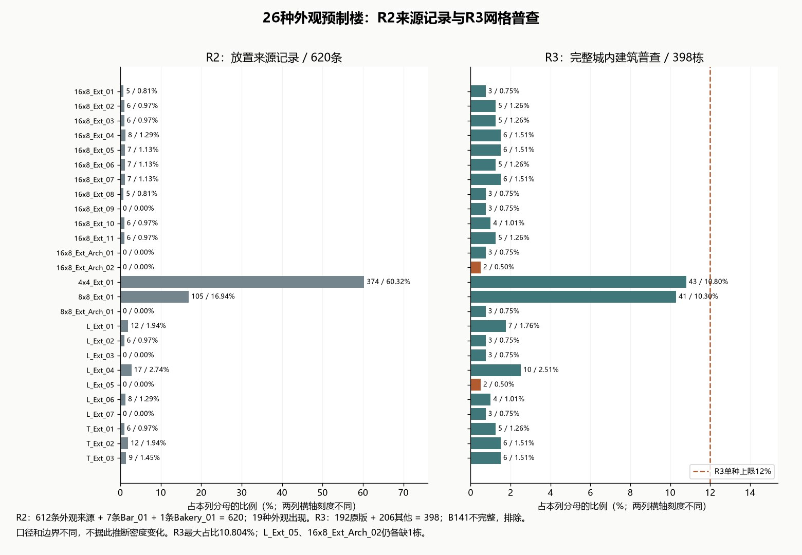

# HarborCity R3 最终审阅候选

存档与地图往返回归已修复。独立包和四段录像已制作；本轮仍有验收失败，以下画面保留实际问题，交付不代表验收通过。

城内楼型更丰富，4×4和8×8原版各低于12%；两种外观仍各缺一栋。

城堡山已有植被与围合；通往王座厅的连续导航仍有断路，30分钟探索未完成。

西郊增加林地、农田和篱笆，但远处平地接海的过渡仍不足。

19个位置都保留在巡览中；部分房间仍空、过暗或过亮，B141建筑壳尚未完整。

主片5分36秒，包含室内、街面、黄昏夜景与战斗；镜头遮挡和录制帧率未达标。

飞行片69秒，由四次真实飞行拼接；不是一次连续飞遍全城。

三条巷道、公会进出和驾车均有展示；近物遮挡仍明显，不能据抽帧认定全路线通过。

穿插候选有所下降，但没有清零，也没有新增已接受的豁免。

R2全图620栋与R3城内398栋的统计范围不同；比例变化不等于建筑密度比较。
